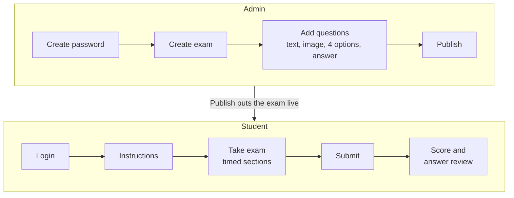

# NEET-PG Mock Test Simulator

Practice NEET-PG on an interface that looks and works like exam day. Admins publish their own mock tests; students take them.

> Unofficial and free. Not affiliated with NBEMS. The demo questions are original sample content.

## Start

You need [Python 3.10+](https://www.python.org/downloads/) and [Node.js 20+](https://nodejs.org).

```sh
git clone https://github.com/muppidisampathreddy/NEET-PG_Simulator.git
cd NEET-PG_Simulator
python3 run.py          # Windows: python run.py
```

This one command installs everything, builds the app and opens your browser.

| Who | Open |
|---|---|
| Students | http://localhost:8000 |
| Admin | http://localhost:8000/#/admin |

The first time you open the admin page, it asks you to create a password. A demo exam is already published, so students can start right away.

## How it works



Answers stay on the server until the student submits, so they can't be found in the browser.

## What's inside

- **Exam screen:** the same layout, colors and question palette as the real test, section-wise timer, Mark for Review, and Clear Response
- **Tools:** calculator, highlighter and notes, magnifier, dark mode, font size, and image zoom
- **Admin:** create exams, add questions with images, set marking (+4 / −1 by default), and publish or unpublish

## Common tasks

| Task | How |
|---|---|
| Let students on the same Wi-Fi join | `HOST=0.0.0.0 python3 run.py`, then open `http://<your-IP>:8000` on their devices |
| Use a different port | `PORT=9000 python3 run.py` |
| Reset a forgotten admin password | Stop the server, run `sqlite3 backend/data.db "delete from settings"`, and start again. Your exams are kept. |
| Back up your exams | Copy `backend/data.db` and `backend/uploads/` |

**Hosting it online?** Open `/#/admin` and set the password right after deploying. Until it is set, anyone who opens that page can choose it.

## Develop

Stack: React 19 + TypeScript + Vite (frontend), FastAPI + SQLite (backend).

```sh
# Terminal 1: API with auto-reload on :8000
cd backend && .venv/bin/uvicorn main:app --reload

# Terminal 2: app with hot reload on :5173
cd frontend && npm run dev

# Tests
cd frontend && npm test
cd backend && .venv/bin/python test_api.py
```

Run `python3 run.py` once first to install everything. API docs are at http://localhost:8000/docs.

```
run.py            one-command launcher
backend/main.py   API, database, image uploads
backend/seed/     demo exam loaded on first run
frontend/src/     React screens (components/) and exam logic (exam.ts)
```

## Contributing

Pull requests are welcome. Please keep questions original: don't copy from coaching platforms or past papers.

## License

[MIT](LICENSE)
