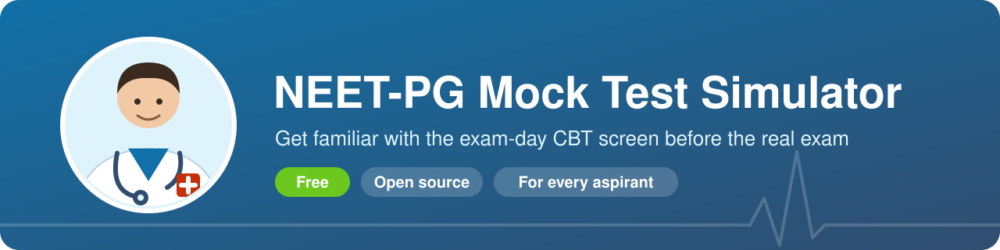
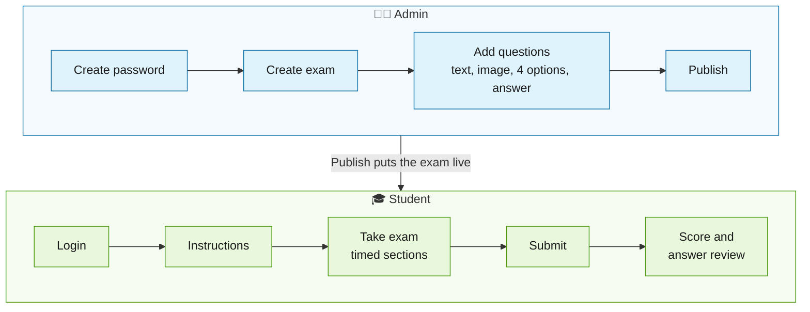
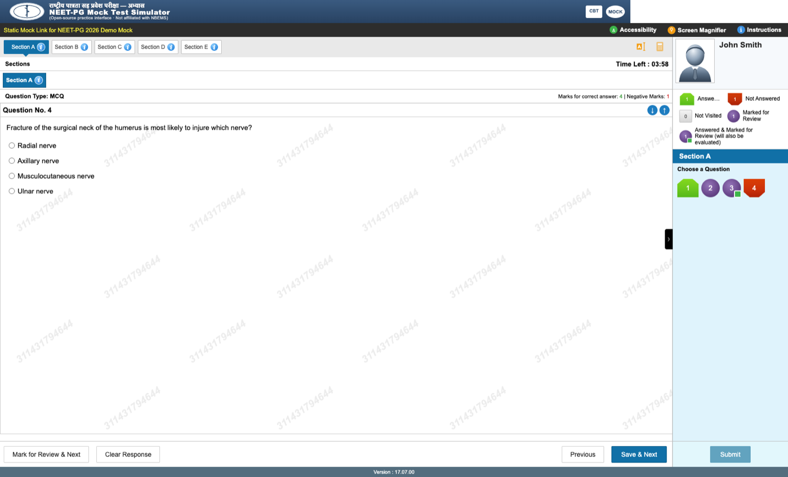
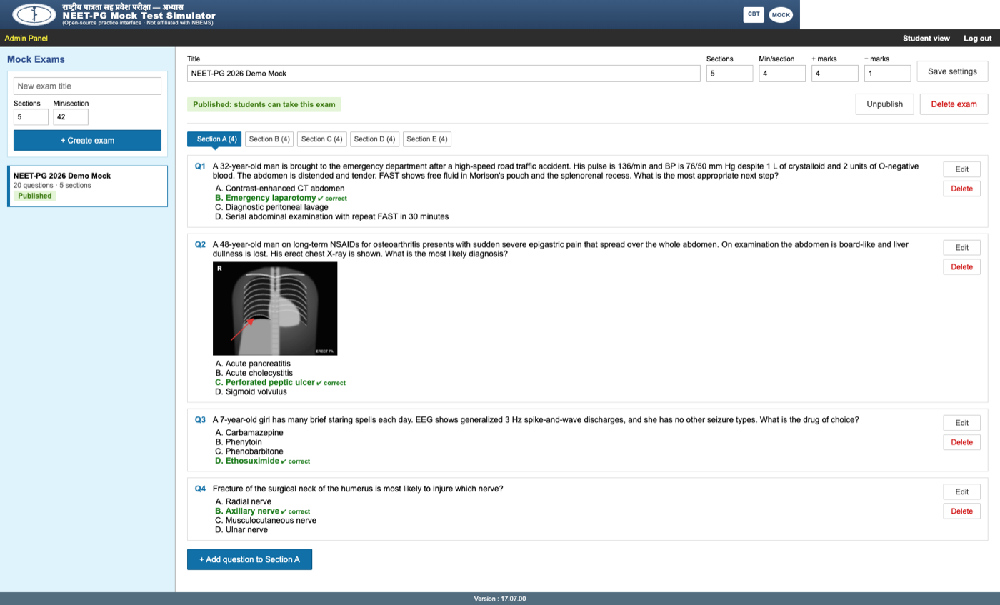

<p align="center">
  
</p>

<p align="center">
  
  
  
  
  
</p>

<p align="center"><b>🩺 Practice on a screen that looks and works like the real NEET-PG computer-based test.</b></p>

---

## 🎯 Why this exists

For many students, NEET-PG is their **first computer-based test**. On exam day they meet a new screen: the question palette, colored status shapes, a section timer, Mark for Review. Learning all that under pressure costs time and confidence.

This simulator lets them **try that experience beforehand**. After a few practice runs the screen feels familiar, so on the real day they can focus on the questions instead of the interface.

> [!TIP]
> Two or three full practice runs are usually enough to get comfortable with the interface.

## 🤝 Help someone get exam-ready

Not every aspirant has a computer at home. Many in villages and small towns have never used a CBT interface before the real exam.

**If you're comfortable with tech, you can help.** Set this up once on a laptop, and students can take turns practising on it. Connect a few computers on the same Wi-Fi and a whole group can take a mock together, at a library, school, coaching centre or community hall.

> [!IMPORTANT]
> No internet is needed during the exam. One laptop running the simulator is enough for a small batch of students.

## 🧭 How it works



## 📸 Screenshots

| Exam screen | Admin panel |
|---|---|
|  |  |

## ✨ What's inside

| | Feature |
|---|---|
| 🖥️ | **Exam-day layout:** the same screens, colors, question palette and status shapes |
| ⏱️ | **Section-wise timer** that moves on automatically, like the real exam |
| 🛠️ | **Tools:** calculator, highlighter and notes, magnifier, dark mode, font size, image zoom |
| 📝 | **Admin panel:** add questions with images, set marking (+4 / −1), publish or unpublish |
| 📊 | **Result:** score, section summary and an answer review with explanations |
| 🔒 | Answers stay on the server until the student submits |

## 🚀 Getting started

You need [Python 3.10+](https://www.python.org/downloads/) and [Node.js 20+](https://nodejs.org).

```sh
git clone https://github.com/muppidisampathreddy/NEET-PG_Simulator.git
cd NEET-PG_Simulator
python3 run.py          # Windows: python run.py
```

This one command installs everything, builds the app and opens your browser.

| Who | Open |
|---|---|
| 🎓 Students | http://localhost:8000 |
| 👨‍⚕️ Admin | http://localhost:8000/#/admin |

On the first visit, the admin page asks you to create a password. A demo exam is already published, so students can start right away.

| Task | Command |
|---|---|
| Let others on the same Wi-Fi join | `HOST=0.0.0.0 python3 run.py`, then open `http://<your-IP>:8000` on their computers |
| Use a different port | `PORT=9000 python3 run.py` |
| Reset a forgotten admin password | Stop the server, run `sqlite3 backend/data.db "delete from settings"`, start again. Exams are kept. |
| Back up your exams | Copy `backend/data.db` and `backend/uploads/` |

> [!WARNING]
> Hosting it online? Open `/#/admin` and set the password right after deploying. Until it is set, anyone who opens that page can choose it.

<details>
<summary><b>🧑‍💻 For developers</b></summary>

Stack: React 19 + TypeScript + Vite, FastAPI + SQLite. Run `python3 run.py` once to install everything, then:

```sh
cd backend && .venv/bin/uvicorn main:app --reload    # API on :8000
cd frontend && npm run dev                           # app with hot reload on :5173
cd frontend && npm test                              # tests
cd backend && .venv/bin/python test_api.py
```

API docs: http://localhost:8000/docs

```
run.py            one-command launcher
backend/main.py   API, database, image uploads
backend/seed/     demo exam loaded on first run
frontend/src/     React screens (components/) and exam logic (exam.ts)
```

</details>

## 💙 Contributing

Pull requests are welcome. Please keep questions original: don't copy from coaching platforms or past papers.

---

<p align="center">
  <sub>MIT licensed · Unofficial and not affiliated with NBEMS · Demo questions are original sample content</sub>
</p>
